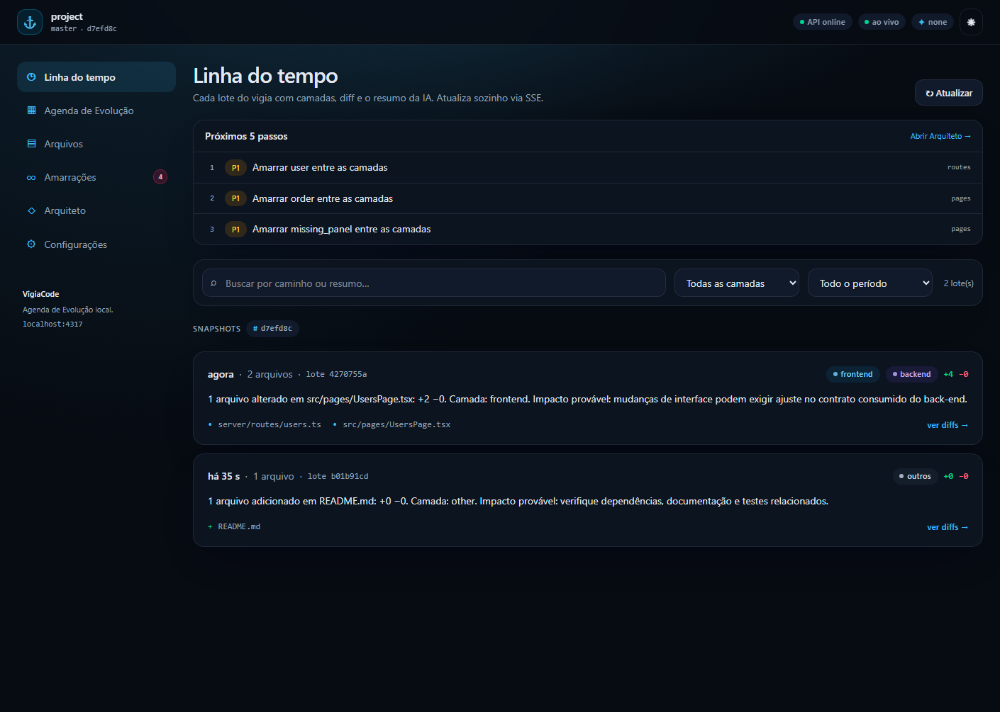
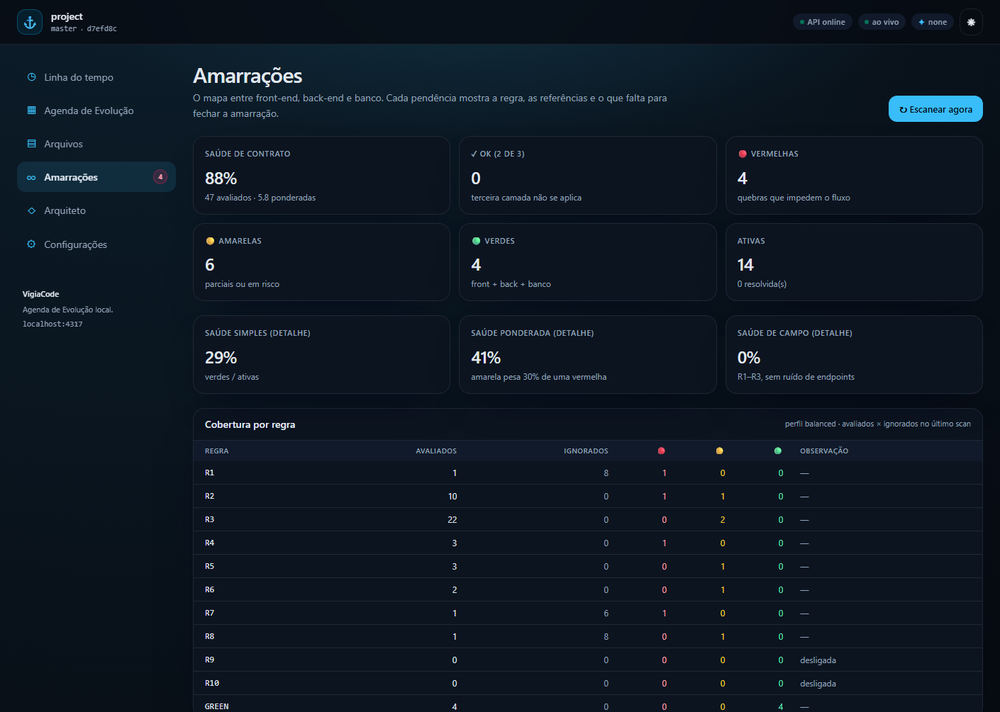
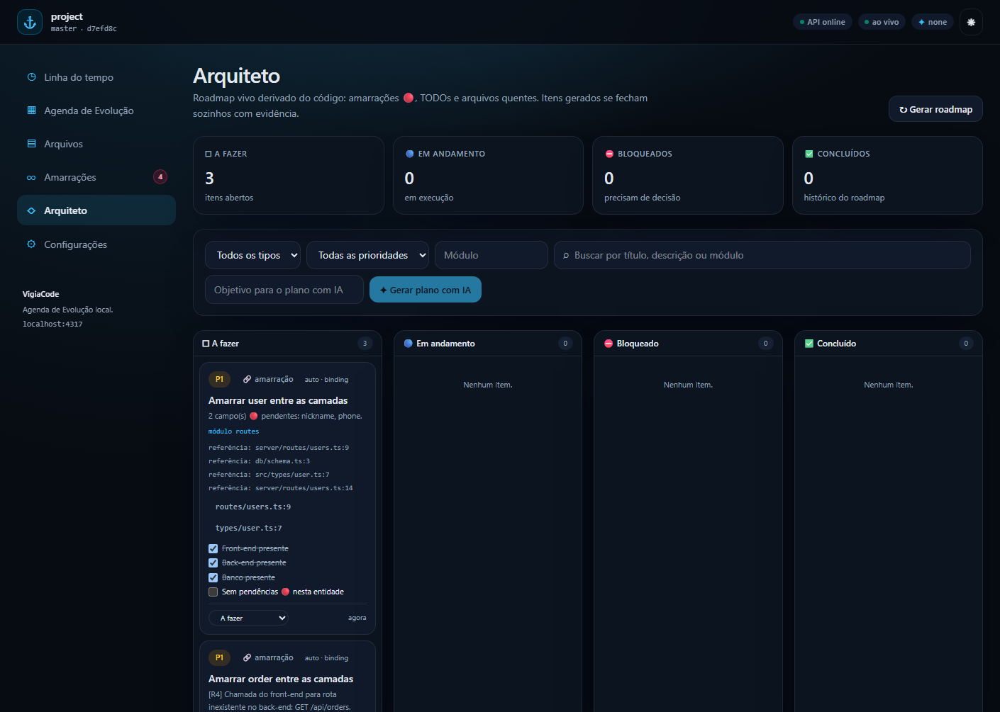

# ⚓ VigiaCode

**AI Dev Companion and architecture tracker for teams building with AI agents** (Cursor, Claude Code, Qoder, Trae).

VigiaCode follows your project as it evolves: it records every change with a diff, summarizes what happened, detects **missing bindings** across frontend, backend and database, and turns the diagnosis into a **living roadmap** of next steps. Everything runs locally in a single npm package with the dashboard embedded.

> **Status: 0.1.0 — Release (Stages 1–6).**
> `npx vigiacode start` serves the dashboard at `http://localhost:4317` with **contract health** as the main metric, the binding matrix (🔴/🟡/🟢/✓ ok), the Architect board and an MCP server so the agent can inspect the project before coding. npm packaging, Docker and CI are ready — see [RELEASE.md](RELEASE.md).



---

## Installation

Requirement: **Node.js 20 or 22**. The database uses `better-sqlite3`, which ships prebuilt binaries for common platforms. If your environment must compile it:

| Platform | Requirements                                         |
| -------- | ---------------------------------------------------- |
| Windows  | Visual Studio Build Tools (C++ Desktop) and Python 3 |
| macOS    | Xcode Command Line Tools (`xcode-select --install`)  |
| Linux    | `build-essential`, `python3` and `make`              |

If loading the native module fails, the CLI prints a friendly message and suggests `npm rebuild better-sqlite3`. The package already contains the compiled dashboard — no monorepo build needed when installing from npm.

### Quick start (3 commands)

In the root of the project you want to track:

```bash
npx vigiacode init --yes      # creates .vigiacode/ (config, SQLite and optional .env)
npx vigiacode bindings scan   # runs rules R1–R10 and computes contract health
npx vigiacode start           # dashboard at http://localhost:4317
```

For a fixed binary on your PATH: `npm install -g vigiacode`. From source:

```bash
pnpm install && pnpm build
node packages/cli/dist/index.js init
node packages/cli/dist/index.js start
```

### Docker

The image runs as non-root, mounts the project **read-only** and keeps VigiaCode state in its own volume:

```bash
docker build -t vigiacode:0.1.0 .
docker run --rm -p 4317:4317 \
  -v "$PWD:/project:ro" \
  -v vigiacode-state:/project/.vigiacode \
  vigiacode:0.1.0
```

Or `docker compose up --build`. On first run the entrypoint executes `vigiacode init --yes --no-gitignore`, then `vigiacode start --host 0.0.0.0`. AI keys come from environment variables (`-e OPENAI_API_KEY=...`), never from the image.

### CI

```bash
vigiacode bindings scan --fail-on red     # exit 1 when there are 🔴 items
```

A ready-to-paste GitHub Actions workflow is in [docs/ci.md](docs/ci.md).

---

## What is included

- pnpm monorepo (`packages/cli`, `packages/web`) published as a single npm package named `vigiacode`.
- TypeScript strict/ESM CLI with **Commander**, dashboard embedded in `dist/web` and migrations in `dist/drizzle`.
- Local **SQLite** database (better-sqlite3) with **Drizzle ORM** and drizzle-kit migrations.
- **Fastify** server at `localhost:4317`: health check, project, events, snapshots, statistics, files, SSE, AI status/test and static dashboard.
- **File watcher** with chokidar: config + `.gitignore` ignores, debounce batching and `add`/`change`/`unlink` capture.
- **Git diffs** via simple-git (including untracked files), configurable truncation and per-commit snapshots.
- **Multi-provider AI**: `openai`, `anthropic`, `gemini`, `openai-compatible` (OpenRouter, Groq, DeepSeek, LM Studio…), `ollama` and the local `none` heuristic, with async queue and fallback chain.
- **Binding detector**: extractors for React/Vue/Svelte, Express/Fastify/Nest/Next, Spring, FastAPI, Drizzle, Prisma, TypeORM, JPA and SQL migrations; rules R1–R10, entity × layer matrix, incremental scans, hash cache and AI explanations.
- **Contract health** as the main metric: `1 − (weighted pending / evaluated items)`, where 🔴 weighs 1 and 🟡 weighs 0.3, plus a **✓ ok** state for two-layer contracts where the third layer does not apply.
- **The Architect**: deterministic living roadmap from 🔴 bindings, `TODO/FIXME/HACK` debt **grouped by module**, and hot files without tests; checklists with auto-verification, evidence-based auto-close and optional AI plans.
- **MCP server**: `vigiacode mcp` over stdio with tools, resources and a prompt for Cursor, Claude Code, Qoder and Trae.
- **React 19 + Vite 7 + Tailwind 4 dashboard**: timeline, evolution agenda, files, Bindings and Architect pages with SSE, settings and light/dark themes.
- **Packaging and delivery**: `npm pack`, clean install outside the monorepo, multi-stage Dockerfile, compose file, CI (Ubuntu/Windows/macOS × Node 20/22) and a tag-based release workflow.
- **Docs**: README pt/en, CONTRIBUTING, CODE_OF_CONDUCT, SECURITY, CHANGELOG, issue/PR templates and docs/ci.md.
- Commands `vigiacode init`, `start`, `log`, `ai test`, `ai use`, `bindings scan/list/matrix`, `architect generate/list/plan/done` and `mcp`, with messages in Portuguese.
- ESLint + Prettier + **184 tests** (166 CLI + 18 web) using **Vitest** and **Testing Library**.

**Out of scope for 0.1.0 (public roadmap):** historical architecture reports, PostgreSQL support and framework-specific rules.

---

## The Watcher

When you run `vigiacode start`, VigiaCode:

1. Opens the local database and applies pending migrations.
2. Detects whether the project is a Git repository (otherwise it warns and records events without diffs).
3. Watches the project root with **chokidar**, honoring `watch.ignore`, the user's `.gitignore` and fixed ignores (`node_modules`, `dist`, `.git`, `.vigiacode`, coverage…).
4. Ignores binaries and files larger than `watch.maxFileSizeKb` (default 500 KB).
5. Groups rapid changes into a **batch** after `watch.debounceMs` (default 1500 ms) — ideal for agents editing several files at once.
6. Captures the diff against `HEAD` for every file in the batch, including full diffs for new/untracked files and removal diffs for `unlink`.
7. Truncates diffs above `git.maxDiffKb` (default 200 KB) and flags `diffTruncated`.
8. Writes one `change_events` row per file with `batch_id` and `layer` (`frontend`, `backend`, `database`, `config`, `other`).
9. Publishes events over SSE and queues the AI summary asynchronously (the event appears immediately with `summary: null`).
10. Checks `HEAD` on every batch and every 5 s; a new commit creates a row in `snapshots`.

Use `vigiacode start --no-watch` to run the API only.

### AI summaries

| Provider            | Environment variable                         | Default model             | Example                                                                                      |
| ------------------- | -------------------------------------------- | ------------------------- | -------------------------------------------------------------------------------------------- |
| `none`              | —                                            | local heuristic           | `vigiacode ai use none`                                                                      |
| `openai`            | `OPENAI_API_KEY` (or `VIGIACODE_API_KEY`)    | `gpt-4o-mini`             | `vigiacode ai use openai --model gpt-4o-mini`                                                |
| `anthropic`         | `ANTHROPIC_API_KEY` (or `VIGIACODE_API_KEY`) | `claude-3-5-haiku-latest` | `vigiacode ai use anthropic --model claude-3-5-haiku-latest`                                 |
| `gemini`            | `GEMINI_API_KEY` or `GOOGLE_API_KEY`         | `gemini-2.0-flash`        | `vigiacode ai use gemini --model gemini-2.0-flash`                                           |
| `openai-compatible` | `VIGIACODE_API_KEY`                          | user-defined              | `vigiacode ai use openai-compatible --base-url https://openrouter.ai/api/v1 --model <model>` |
| `ollama`            | —                                            | `llama3.2`                | `vigiacode ai use ollama --model llama3.2`                                                   |

Keys live **only** in environment variables (or `.vigiacode/.env`), never in `config.json` or the database. `VIGIACODE_API_KEY` is a generic fallback for OpenAI, Anthropic and Gemini, and is the variable used by `openai-compatible`. If AI fails, expires or is not configured, the local heuristic takes over. `vigiacode ai test` sends a short prompt and explains common errors (missing key, 401/403, 404, timeout, Ollama offline).

---

## Dashboard

`vigiacode start` serves the dashboard at **http://localhost:4317**. The UI is local, in Portuguese and works offline (except for configured AI APIs).

- **Timeline**: batches grouped by `batch_id`, relative time, layer badges, `+lines/−lines`, AI summary, live SSE updates, filters and a colored diff drawer.
- **Evolution agenda**: per-day batches/files, hottest layers, snapshots.
- **Files**: most changed files, layer, latest summary and full history.
- **Bindings**: **contract health** card, ✓ ok items, 🔴/🟡/🟢 counts, weighted/simple/field health as detail, per-rule coverage, entity × layer matrix, scan evolution chart, grouping by module/rule and a filterable list with clickable references, AI explanation and “accept as false positive”.
- **Architect**: `todo/doing/blocked/done` kanban with module/kind/priority filters, evidence cards, checklists and an AI plan button.
- **Settings**: read-only config, provider/model, key presence (never the key) and an AI test button.





Frontend development: `pnpm dev` (CLI watch + Vite at `http://localhost:5173`, proxying `/api` to 4317), `pnpm build` (embeds the UI into `packages/cli/dist/web`).

---

## Binding detector

VigiaCode cross-checks **frontend, backend and database**, assigning each field/entity/route a state:

- 🔴 **red**: missing binding (field/call without a counterpart);
- 🟡 **yellow**: partial, type mismatch, mock/localStorage or architecture rule;
- 🟢 **green**: frontend, backend and database present and consistent;
- **✓ ok**: two layers present and consistent; the third does not apply (e.g. a frontend-consumed read endpoint with no table of its own). Counts as evaluated without pending work.

It is **generic by design**: extractors combine the TypeScript compiler API (TS/JS), robust regex (Java, Python, SQL, Prisma) and path heuristics for React/Vue/Svelte, Express/Fastify/Nest/Next, Spring, FastAPI, Drizzle, Prisma, TypeORM, JPA and Flyway/Liquibase migrations. Scans are serialized; files are cached by SHA-1 in `binding_file_cache`, so incremental scans only reparse changed files.

### Rules

| Rule    | Default | What it detects                                                                                 |
| ------- | ------- | ----------------------------------------------------------------------------------------------- |
| **R1**  | 🔴 on   | Field used in the frontend (type, form or payload) with no field in the backend DTO/route.      |
| **R2**  | 🔴 on   | DTO field with no entity/schema column. Becomes 🟡 when the column exists but the type differs. |
| **R3**  | 🟡 on   | Schema column without a migration that creates it — and the reverse.                            |
| **R4**  | 🔴 on   | Frontend call to a backend route that does not exist (method + normalized path).                |
| **R5**  | 🟡 on   | Backend endpoint without any frontend consumer.                                                 |
| **R6**  | 🟡 on   | Entity with an API but no screen, or a screen using only mocks/localStorage.                    |
| **R7**  | 🔴 on   | Referenced component/route without a definition, or broken relative import.                     |
| **R8**  | 🟡 on   | “Exists elsewhere, binding missing”: similar names across modules without a deterministic link. |
| **R9**  | ⚪ off  | Monetary value as float/double/number (prefer decimal or integer cents).                        |
| **R10** | ⚪ off  | Architecture rules: controller accessing repository/DAO directly and cross-module imports.      |
| GREEN   | —       | Field present and consistent in frontend, backend and database.                                 |

### Config, disabling rules and false positives

Everything lives in `.vigiacode/config.json` under `bindings` (older configs receive defaults automatically):

```json
"bindings": {
  "profile": "balanced",
  "rules": {
    "R1": { "enabled": true, "severity": "red" },
    "R2": { "enabled": true, "severity": "red" },
    "R3": { "enabled": true, "severity": "yellow" },
    "R4": { "enabled": true, "severity": "red" },
    "R5": { "enabled": true, "severity": "yellow" },
    "R6": { "enabled": true, "severity": "yellow" },
    "R7": { "enabled": true, "severity": "red" },
    "R8": { "enabled": true, "severity": "yellow" },
    "R9": { "enabled": false, "severity": "yellow" },
    "R10": { "enabled": false, "severity": "yellow" }
  },
  "ignore": ["src/generated/**", "**/*.stories.tsx"],
  "acceptedFalsePositives": ["R2:user:nickname", "R3:audit_log:created_at"],
  "semanticMatching": true,
  "r1IncludeTypes": true
},
"architect": { "todoComments": true }
```

- `profile`: `strict` (all rules), `balanced` (default) and `lenient` (R5/R6 off when the frontend has no typed HTTP client). Explicit `rules` entries win per rule.
- `rules.<R>.severity` swaps 🔴 for 🟡 (or vice versa).
- `ignore` accepts the same glob patterns as the watcher.
- `acceptedFalsePositives` accepts `"R1:user:phone"` or `{ "rule": "R1", "entity": "user", "field": "phone" }`; it is the single source of truth and is versioned with the project. The dashboard’s **Accept as false positive** button writes to `config.json`.
- `semanticMatching` enables the second matcher phase (synonyms and optional LLM); with `none` only the local heuristic runs, no network.
- `r1IncludeTypes` includes fields that exist only in frontend types/interfaces. Disable it in projects with many view models/projections.
- `architect.todoComments: false` disables `TODO/FIXME/HACK` collection in the roadmap.

### Contract health, coverage and noise

```text
contract health = 1 − (weighted pending ÷ evaluated items)
weighted pending = 🔴 × 1 + 🟡 × 0.3
```

✓ ok items count as evaluated without pending work. The **per-rule coverage** is frozen in the last scan (`coverage_json`): evaluated, ignored (tests, mocks, generated), results (🔴/🟡/🟢/✓ ok) and why a rule is off (config or profile). The dashboard, CLI scan summary and MCP `vigiacode_status` all report contract health as the primary number; simple, weighted and field health remain as detail.

### CLI

```bash
vigiacode bindings scan                 # full scan; exit 1 when there are 🔴
vigiacode bindings scan --fail-on red   # explicit (default)
vigiacode bindings scan --fail-on yellow
vigiacode bindings scan --fail-on none  # never fails (reports)
vigiacode bindings list --status red --layer backend
vigiacode bindings list --rule R3 --resolved
vigiacode bindings matrix               # entity × front × back × database
```

### Fixtures

`packages/cli/test/fixtures/`: `react-fastify-drizzle` (R1, R2 field+type, R3×2, R4, R5, R6, R7, R8 + 4 green fields), `react-spring-flyway` (R1, R2 field+type, R3×2, R4, R5, R8 + 2 green) and `next-prisma` (R1, R2, R3×2, R4, R5, R6, R7 + 4 green).

### Real-project validation

The detector was run on **SythaxSystem** (React + Spring Boot + Flyway) in read-only mode, without starting the project's database or API: **2,589 files**, **3🔴 / 1,005🟡 / 0🟢 / 2 ✓ ok**, **contract health 94.6%** (5,656 evaluated, 304.5 weighted pending), first scan in **88 s** and cached rescans in **15–22 s**. Details in [docs/validacao-sythaxsystem.md](docs/validacao-sythaxsystem.md).

---

## The Architect

The Architect turns diagnosis into a **living roadmap**: prioritized items with evidence and checklists that open and close as the code changes. Everything is stored locally (`roadmap_items` + `roadmap_links`, migration `0004_architect.sql`).

| Source                                                 | Kind      | Priority | Grouping rule                                                    |
| ------------------------------------------------------ | --------- | -------- | ---------------------------------------------------------------- |
| 🔴 bindings grouped by entity                          | `binding` | `p1`     | one item per entity (not per field), with `file:line` links      |
| `FIXME` and `HACK` comments                            | `debt`    | `p2`     | **one item per module**, with a `file:line` list in the evidence |
| `TODO` comments                                        | `debt`    | `p3`     | **one item per module**, with a `file:line` list in the evidence |
| Hot file (≥3 changes in 30 days) with no matching test | `test`    | `p2`     | one item per file, with recent history as evidence               |

- **Grouped debt**: every `TODO/FIXME/HACK` in a module becomes one item titled “Zerar débitos … em `<module>`”; the evidence keeps one line per comment. A module with at least one `FIXME`/`HACK` is `p2`; TODO-only modules are `p3`. Incremental scans reread only changed files and keep the other comments from history.
- **Auto-close**: when the problem disappears (🔴 binding gone, comment removed or test added), the generated item becomes `done` with evidence and `closed_at`. If it returns, the item is **reopened** instead of duplicated.
- **Manual items** are never closed, deleted or reopened by the Architect.
- `vigiacode architect plan "<objective>"` generates an execution plan with the configured AI or the local heuristic when `provider none`.
- **Next 5 steps**: the timeline shows the top open items by priority and **ignores `p3` debt**.

```bash
vigiacode architect generate            # scan and generate/update the roadmap
vigiacode architect generate --no-scan  # use the current database state
vigiacode architect list --status todo --priority p1
vigiacode architect list --kind binding --module users
vigiacode architect plan "connect the orders screen to the backend"
vigiacode architect done <id> --note "done in PR #42"
```

---

## MCP server

`vigiacode mcp` starts a **Model Context Protocol** server over **stdio**, so the agent can inspect the project before coding and update the roadmap afterwards.

```bash
vigiacode mcp                          # current directory
vigiacode mcp --project /path/to/app   # another initialized root
```

### Tools

| Tool                       | What it does                                                                                                                                      |
| -------------------------- | ------------------------------------------------------------------------------------------------------------------------------------------------- |
| `vigiacode_status`         | **contract health** (primary), evaluated items, weighted pending and ok; 🔴/🟡/🟢 counts, detail health, coverage, profile, roadmap and last scan |
| `vigiacode_bindings`       | lists bindings with `file:line`; filters `status`, `entity`, `rule`, `module`, `includeResolved`, `limit`                                         |
| `vigiacode_check_entity`   | cross-checks an entity across the three layers and returns its matrix row + pending + green items                                                 |
| `vigiacode_roadmap`        | roadmap items and counts; filters `status`, `kind`, `priority`, `module`, `search`                                                                |
| `vigiacode_roadmap_update` | **the only write tool**: status, priority, title, description/note and checklist of an item                                                       |
| `vigiacode_recent_changes` | recent watcher events; filters `limit`, `layer`, `sinceMinutes`                                                                                   |
| `vigiacode_scan`           | runs the detector (incremental with `changedFiles`, full otherwise) and returns before/after/delta counts                                         |

### Resources and prompt

- `vigiacode://summary` — consolidated status (JSON).
- `vigiacode://matrix` — entity × front × back × database matrix from the last scan.
- `vigiacode://roadmap` — roadmap items and counts.
- Prompt **`antes-de-codar`** (optional `objetivo` argument): a checklist that tells the agent to check status, red bindings, the affected entity and the roadmap before editing, then run `vigiacode_scan` + `vigiacode_roadmap_update` afterwards.

### Editor configuration

Minimal config when the package is installed (global or via `npx`):

```json
{
  "mcpServers": {
    "vigiacode": {
      "command": "npx",
      "args": ["-y", "vigiacode", "mcp", "--project", "/path/to/your-project"]
    }
  }
}
```

**Cursor** — `.cursor/mcp.json` in the project root:

```json
{
  "mcpServers": {
    "vigiacode": {
      "command": "node",
      "args": [
        "C:/path/to/vigiacode/packages/cli/dist/index.js",
        "mcp",
        "--project",
        "C:/path/to/your-project"
      ]
    }
  }
}
```

**Claude Code**:

```bash
claude mcp add vigiacode -- npx -y vigiacode mcp --project /path/to/your-project
```

**Qoder** — _Settings → MCP_ (or the workspace `mcp.json`), same stdio format:

```json
{
  "mcpServers": {
    "vigiacode": {
      "command": "node",
      "args": [
        "C:/path/to/vigiacode/packages/cli/dist/index.js",
        "mcp",
        "--project",
        "C:/path/to/your-project"
      ]
    }
  }
}
```

**Trae** — _MCP → Add → Manual_, **stdio** transport, same `command`/`args`.

> The server uses **stdout only for the MCP protocol**. Diagnostics go to **stderr**, so logs never corrupt the editor session.

### Security

- The MCP **only reads** the local project and the VigiaCode database.
- The **only write** is `vigiacode_roadmap_update`, restricted to the project’s own database.
- No `.env`, keys or secrets are read or exposed; `vigiacode_status` shows at most the configured provider/model.
- It never starts your application server or database.

---

## Stack

| Layer    | Choice                                                                       |
| -------- | ---------------------------------------------------------------------------- |
| Runtime  | Node.js 20+ (ESM)                                                            |
| Monorepo | pnpm workspaces                                                              |
| CLI      | TypeScript strict, Commander                                                 |
| API      | Fastify 5 + SSE                                                              |
| Watcher  | chokidar 4                                                                   |
| Git      | simple-git                                                                   |
| Database | SQLite (better-sqlite3) + Drizzle ORM + drizzle-kit                          |
| Web      | React 19 + Vite 7 + Tailwind 4 + React Router + TanStack Query               |
| Quality  | ESLint 9 (flat config), Prettier, Vitest, Testing Library, TypeScript strict |

Database access is isolated in `packages/cli/src/db/`; adding PostgreSQL later means adding an equivalent schema/repository and swapping the client.

---

## Commands

| Command                         | What it does                                                         |
| ------------------------------- | -------------------------------------------------------------------- |
| `vigiacode init`                | Creates `.vigiacode/`, applies migrations, registers the project     |
| `vigiacode start`               | API + watcher + dashboard at `localhost:4317`                        |
| `vigiacode log`                 | Lists recent events with layer, change type, line counts and summary |
| `vigiacode ai test`             | Tests the configured AI provider                                     |
| `vigiacode ai use <provider>`   | Switches provider/model/endpoint without re-running `init`           |
| `vigiacode bindings scan`       | Full binding scan; exit code controlled by `--fail-on`               |
| `vigiacode bindings list`       | Filterable binding list with references and suggestions              |
| `vigiacode bindings matrix`     | Entity × front × back × database matrix                              |
| `vigiacode architect generate`  | Runs (or reuses) the scan and generates/updates the roadmap          |
| `vigiacode architect list`      | Kanban-style roadmap list with filters                               |
| `vigiacode architect plan`      | Execution plan for an objective (AI or heuristic)                    |
| `vigiacode architect done <id>` | Manually completes an item                                           |
| `vigiacode mcp`                 | Starts the MCP stdio server                                          |

---

## FAQ

**Do I need an AI key?**
No. The default is `none`, which uses a local heuristic. AI only improves summaries and binding explanations.

**Does VigiaCode modify my project?**
No. It reads the code and writes only to `.vigiacode/`. In Docker, `/project` is read-only.

**Where are keys stored?**
Only in environment variables or `.vigiacode/.env`. Never in `config.json`, the database, the dashboard or API responses.

**Why is contract health different from weighted health?**
Contract health divides weighted pending by **evaluated items**, including yellow items and ok items; weighted health compares only green items against pending. Contract health is more informative in projects without perfect three-layer field triples.

**Is “✓ ok” the same as green?**
No. Green requires frontend + backend + database. Ok means frontend + backend are consistent and the third layer does not apply (read endpoint, projection, non-persisted DTO).

**How do I reduce noise?**
Use the `lenient` profile, `r1IncludeTypes: false` in projects with many view models, and `acceptedFalsePositives` for one-off cases instead of disabling whole rules.

**Does it work without Git?**
Yes, but without diffs. Events and heuristic summaries are still recorded; commit snapshots stay empty.

**Does the MCP server start my server?**
No. The only write is a roadmap item update.

**Node 26?**
It may work, but 0.1.0 does not support it: the `better-sqlite3` prebuilt binary may be missing. Use Node 20 or 22.

**How can I contribute?**
See [CONTRIBUTING.md](CONTRIBUTING.md). For security issues, use [SECURITY.md](SECURITY.md).

---

## Public roadmap

| Priority  | Idea                                                          |
| --------- | ------------------------------------------------------------- |
| Exploring | Historical architecture reports and health trends over time   |
| Exploring | PostgreSQL support in the same schema/repository              |
| Exploring | More extractors and framework presets (Laravel, Django, .NET) |
| Idea      | Project-configurable rules without code                       |
| Idea      | Health comparison across branches/PRs in the dashboard        |

Feature suggestions are welcome through the issue template.

---

## License

[MIT](LICENSE) © 2026 José Júnior
