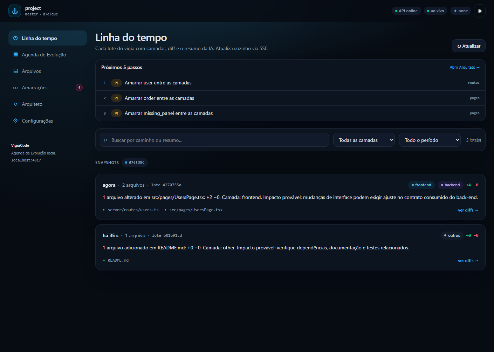
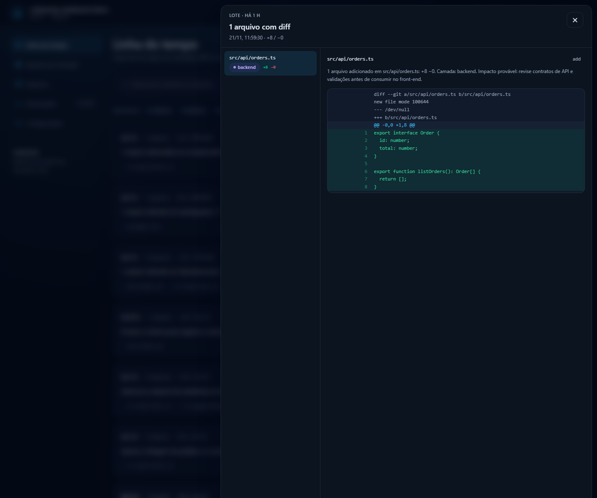

# ⚓ VigiaCode

**AI Dev Companion e rastreador de arquitetura para quem desenvolve com agentes de IA** (Cursor, Claude Code, Windsurf).

O VigiaCode acompanha o seu projeto enquanto o código evolui: registra cada mudança com o diff, resume o que aconteceu e, nas próximas etapas, vai detectar **amarrações pendentes** entre front-end, back-end e banco.

> **Status: Etapa 4 — Detector de Amarrações.**
> O `vigiacode start` serve um dashboard local em `http://localhost:4317` com linha do tempo em tempo real, agenda por dia, ranking de arquivos, configurações, status da IA e o **mapa de amarrações entre front-end, back-end e banco** (🔴/🟡/🟢), atualizado pelo vigia.

---

## O que já existe

- Monorepo com **pnpm workspaces** (`packages/cli` e `packages/web`).
- CLI `vigiacode` em TypeScript strict/ESM com **Commander**.
- Banco local **SQLite** (better-sqlite3) com **Drizzle ORM** e migrations via **drizzle-kit**.
- Servidor **Fastify** em `localhost:4317` com health check, projeto, eventos, snapshots, estatísticas, arquivos, SSE e status/teste da IA.
- **Vigia de arquivos** com chokidar: ignores do config + `.gitignore`, debounce e captura de `add`/`change`/`unlink`.
- **Diffs do Git** via simple-git, incluindo arquivos novos não rastreados, com truncagem configurável e snapshots por commit.
- **Multi-provedor de IA**: `openai`, `anthropic`, `gemini`, `openai-compatible` (OpenRouter, Groq, DeepSeek, LM Studio…), `ollama` e o heurístico `none`, com fila assíncrona e fallback em cadeia.
- **Detector de amarrações** (Etapa 4): extractors genéricos para React/Vue/Svelte, Express/Fastify/Nest/Next, Spring, FastAPI, Drizzle, Prisma, TypeORM, JPA e migrations SQL; regras R1–R10, matriz entidade × camadas, scan incremental pelo vigia, cache por hash e explicação com IA.
- **Dashboard em React 19 + Vite 7 + Tailwind 4** com tema claro/escuro, linha do tempo, agenda de evolução, arquivos, tela de **Amarrações** com SSE e configurações.
- Comandos `vigiacode init`, `start`, `log`, `ai test`, `ai use` e `bindings scan/list/matrix`, com mensagens em português.
- ESLint + Prettier + **174 testes** (158 no CLI + 16 no web) com **Vitest** e **Testing Library**.

**Ainda não implementado (proposital):** relatórios de evolução e snapshots de arquitetura (Etapa 6).

---

## O Vigia

Quando você roda `vigiacode start`, o VigiaCode:

1. Abre o banco local e aplica as migrations pendentes.
2. Detecta se o projeto é um repositório Git (se não for, avisa e segue registrando eventos sem diff).
3. Observa a raiz do projeto com **chokidar**, respeitando `watch.ignore`, o `.gitignore` do usuário e ignores fixos (`node_modules`, `dist`, `.git`, `.vigiacode`, cobertura etc.).
4. Ignora binários e arquivos maiores que `watch.maxFileSizeKb` (padrão 500 KB).
5. Agrupa mudanças rápidas num **lote** após `watch.debounceMs` (padrão 1500 ms) — ideal para agentes que editam vários arquivos de uma vez.
6. Para cada arquivo do lote, captura o diff em relação ao `HEAD` (`git diff HEAD`), gerando diff completo para arquivos novos/untracked e de remoção para `unlink`.
7. Trunca diffs acima de `git.maxDiffKb` (padrão 200 KB), marcando `diffTruncated`.
8. Grava uma linha em `change_events` por arquivo, com `batch_id` e `layer` (`frontend`, `backend`, `database`, `config`, `other`).
9. Publica os eventos no SSE e enfileira o resumo de IA. O evento entra **na hora com `summary: null`**; o resumo é preenchido depois, sem travar o vigia.
10. Verifica o `HEAD` a cada lote e a cada 5 s; quando um commit novo aparece, grava um snapshot em `snapshots`.
11. Registra no terminal um resumo do lote:

```text
🛰️ 3 arquivos alterados (frontend, backend, database) — resumo: 3 arquivos alterados em src, db: +7 −0. Camada: frontend, backend, database. Impacto provável: ...
```

Use `vigiacode start --no-watch` para subir apenas a API, sem observar arquivos.

### Resumos e IA

| Provider            | Variável de ambiente                         | Modelo padrão             | Exemplo de uso                                                                                |
| ------------------- | -------------------------------------------- | ------------------------- | --------------------------------------------------------------------------------------------- |
| `none`              | —                                            | heurístico local          | `vigiacode ai use none`                                                                       |
| `openai`            | `OPENAI_API_KEY` (ou `VIGIACODE_API_KEY`)    | `gpt-4o-mini`             | `vigiacode ai use openai --model gpt-4o-mini`                                                 |
| `anthropic`         | `ANTHROPIC_API_KEY` (ou `VIGIACODE_API_KEY`) | `claude-3-5-haiku-latest` | `vigiacode ai use anthropic --model claude-3-5-haiku-latest`                                  |
| `gemini`            | `GEMINI_API_KEY` ou `GOOGLE_API_KEY`         | `gemini-2.0-flash`        | `vigiacode ai use gemini --model gemini-2.0-flash`                                            |
| `openai-compatible` | `VIGIACODE_API_KEY`                          | definido por você         | `vigiacode ai use openai-compatible --base-url https://openrouter.ai/api/v1 --model <modelo>` |
| `ollama`            | —                                            | `llama3.2`                | `vigiacode ai use ollama --model llama3.2`                                                    |

As chaves vivem **somente** em variáveis de ambiente (ou no `.vigiacode/.env`), nunca no `config.json` ou no banco. `VIGIACODE_API_KEY` funciona como fallback genérico para OpenAI, Anthropic e Gemini, e é a variável usada por `openai-compatible`. Se a IA falhar, expirar ou não estiver configurada, o resumo heurístico assume automaticamente.

**Exemplos:**

```bash
# OpenAI
export OPENAI_API_KEY="sk-..."                # PowerShell: $env:OPENAI_API_KEY="sk-..."
vigiacode ai use openai --model gpt-4o-mini

# Anthropic
export ANTHROPIC_API_KEY="sk-ant-..."
vigiacode ai use anthropic --model claude-3-5-haiku-latest

# Gemini (GOOGLE_API_KEY também é aceita)
export GEMINI_API_KEY="..."
vigiacode ai use gemini --model gemini-2.0-flash

# OpenRouter / Groq / DeepSeek / LM Studio (API compatível com OpenAI)
export VIGIACODE_API_KEY="sk-or-..."
vigiacode ai use openai-compatible --base-url https://openrouter.ai/api/v1 --model meta-llama/llama-3.1-8b-instruct

# Ollama local
ollama serve && ollama pull llama3.2
vigiacode ai use ollama --model llama3.2
```

**Teste e diagnóstico:**

```bash
vigiacode ai test       # envia um prompt curto e mostra tempo, modelo e resposta
```

O comando explica erros comuns: chave ausente (com exemplos Bash/PowerShell), HTTP 401/403, modelo/endpoint não encontrado (404), timeout e Ollama fora do ar.

**Arquivo `.vigiacode/.env`** (já coberto pelo `.vigiacode/` no `.gitignore`):

```bash
OPENAI_API_KEY=sk-...
VIGIACODE_API_KEY=sk-or-...
```

O `.env` é carregado no `start` e no `ai test`, sem sobrescrever variáveis já definidas no ambiente.

**Fallback opcional** no `config.json`:

```json
"fallback_providers": ["ollama", "none"]
```

Se o provider principal falhar, os fallbacks são tentados em ordem; por último, o resumo heurístico local sempre funciona.

O prompt pede um resumo curto em português com: o que mudou, a camada afetada e o possível impacto. Quando a IA responde, o resumo final também aparece no terminal com `🤖` (o lote em si é logado na hora com o resumo heurístico).

---

## Dashboard — Agenda de Evolução

`vigiacode start` serve o dashboard em **http://localhost:4317**. A interface é local, em português e funciona offline (exceto as APIs de IA, quando configuradas).



```text
┌──────────────────────────────────────────────────────────────────────┐
│ ⚓ projeto · branch · commit     API online · ao vivo · IA · tema  │
├──────────────┬───────────────────────────────────────────────────────┤
│ Linha do     │  Linha do tempo                                       │
│ tempo        │  ┌───────────────────────────────────────────────┐    │
│ Agenda       │  │ há 2 min · 3 arquivos · +7 −0                 │    │
│ Arquivos     │  │ [frontend] [backend] [banco]                  │    │
│ Amarrações   │  │ resumo da IA…                                 │    │
│ Configurações│  └───────────────────────────────────────────────┘    │
└──────────────┴───────────────────────────────────────────────────────┘
```

- **Linha do tempo**: lotes agrupados por `batch_id`, horário relativo, badges de camada, `+linhas/−linhas`, resumo da IA e skeleton “gerando resumo…” que é preenchido pelo SSE. Filtros por camada, texto e período, scroll infinito com `?before` e painel lateral com diff colorido, números de linha e aviso de truncagem.
- **Agenda de Evolução**: visão por dia com quantidade de lotes/arquivos, camadas mais mexidas, lotes do dia e marcadores dos snapshots (hashes curtos).
- **Arquivos**: ranking dos mais alterados, camada, último resumo e histórico completo de cada arquivo.
- **Amarrações**: cards de 🔴/🟡/🟢, % de saúde, matriz entidade × camadas, gráfico de evolução, lista filtrável com referências clicáveis, “Explicar com IA” e “Aceitar como falso positivo”, tudo com SSE e badge de 🔴 na navegação.
- **Configurações**: config atual somente leitura, provider/modelo, presença da chave (nunca a chave) e botão **Testar IA** (`POST /api/ai/test`).
- Tema escuro por padrão, alternância claro/escuro persistida em `localStorage`.
- SSE com reconexão automática e backoff exponencial; indicadores de API e “ao vivo” no cabeçalho.



### Desenvolvimento do front-end

```bash
pnpm dev          # CLI em watch + Vite em http://localhost:5173 (proxy /api → 4317)
pnpm build        # gera packages/web/dist, servido pelo vigiacode start
```

Rotas da interface: `/` (linha do tempo), `/agenda`, `/files`, `/bindings`, `/settings`.

---

## Detector de Amarrações

O detector cruza **front-end, back-end e banco** e transforma cada campo/entidade/rota num estado:

- 🔴 **vermelho**: falta amarrar (campo/chamada sem contraparte);
- 🟡 **amarelo**: parcial, tipo divergente, mock/localStorage ou regra de arquitetura;
- 🟢 **verde**: front, back e banco presentes e consistentes.

Ele é **genérico por design**: não assume uma stack única. Os extractors combinam a TypeScript compiler API (TS/JS), regex robusta (Java, Python, SQL, Prisma) e heurísticas de caminho para reconhecer React/Vue/Svelte, Express/Fastify/Nest/Next, Spring, FastAPI, Drizzle, Prisma, TypeORM, JPA e migrations Flyway/Liquibase.

### Arquitetura (`packages/cli/src/bindings/`)

```text
src/bindings/
├─ extractors/
│  ├─ frontend.ts   tipos/interfaces, forms (name/register/v-model), fetch/axios/ky,
│  │                rotas/páginas, payloads, mocks e localStorage
│  ├─ backend.ts    Express/Fastify/Nest/Next, Spring, FastAPI, DTOs TS/zod/Java/pydantic
│  ├─ database.ts   Drizzle, Prisma, TypeORM, JPA, CREATE/ALTER/DROP TABLE
│  ├─ common.ts     normalização de caminhos, rotas e nomes
│  └─ index.ts      registry dos extractors
├─ names.ts         camel/snake/Pascal, plurais, sufixos Id/Dto/Entity/Page, sinônimos PT/EN
├─ project-map.ts   mapa normalizado do projeto + migrations separadas
├─ matcher.ts       fase determinística + fase semântica (heurística e LLM opcional, cache por hash)
├─ rules.ts         R1–R10 + GREEN
├─ matrix.ts        matriz entidade × front × back × banco
├─ scanner.ts       scan completo/incremental, cache por hash, upsert/resolução
└─ explain.ts       explicação em português + sugestão de código (IA ou heurística)
```

O scan é **serializado** para evitar corrida entre `start`, vigia e API. Arquivos são cacheados em `binding_file_cache` pelo SHA-1 do conteúdo: num scan incremental só os arquivos do lote são reparseados, e as amarrações são recalculadas sobre o mapa em cache.

### Regras

| Regra   | Padrão       | O que detecta                                                                                           |
| ------- | ------------ | ------------------------------------------------------------------------------------------------------- |
| **R1**  | 🔴 ligada    | Campo usado no front (tipo, formulário ou payload) sem campo no DTO/rota do back-end.                   |
| **R2**  | 🔴 ligada    | Campo do DTO sem coluna na entidade/schema. Vira 🟡 quando existe mas o tipo diverge (string × number). |
| **R3**  | 🟡 ligada    | Coluna no schema/entidade sem migration que a crie — e o inverso (migration sem schema).                |
| **R4**  | 🔴 ligada    | Chamada do front para rota inexistente no back (método + path com params normalizados).                 |
| **R5**  | 🟡 ligada    | Endpoint do back sem nenhum consumidor no front.                                                        |
| **R6**  | 🟡 ligada    | Entidade com API mas sem tela, ou tela que só usa mock/localStorage (“só local”).                       |
| **R7**  | 🔴 ligada    | Componente/rota referenciado sem definição ou import relativo quebrado.                                 |
| **R8**  | 🟡 ligada    | “Existe em outro lugar, falta amarrar”: nome parecido entre módulos sem ligação determinística.         |
| **R9**  | ⚪ desligada | Valor monetário como float/double/number (prefira decimal ou centavos inteiros).                        |
| **R10** | ⚪ desligada | Regras de arquitetura: controller acessando repository/DAO direto e imports cruzados entre módulos.     |
| GREEN   | —            | Campo presente e consistente em front, back e banco.                                                    |

### Configurar, desligar e aceitar falsos positivos

Tudo em `.vigiacode/config.json`, na chave `bindings` (configs antigos recebem os padrões automaticamente):

```json
"bindings": {
  "rules": {
    "R1": { "enabled": true, "severity": "red" },
    "R2": { "enabled": true, "severity": "red" },
    "R3": { "enabled": true, "severity": "yellow" },
    "R4": { "enabled": true, "severity": "red" },
    "R5": { "enabled": true, "severity": "yellow" },
    "R6": { "enabled": true, "severity": "yellow" },
    "R7": { "enabled": true, "severity": "red" },
    "R8": { "enabled": true, "severity": "yellow" },
    "R9": { "enabled": false, "severity": "yellow" },
    "R10": { "enabled": false, "severity": "yellow" }
  },
  "ignore": ["src/generated/**", "**/*.stories.tsx"],
  "acceptedFalsePositives": ["R2:user:nickname", "R3:audit_log:created_at"],
  "semanticMatching": true,
  "r1IncludeTypes": true
}
```

- `rules.<R>.enabled=false` desliga a regra;
- `rules.<R>.severity` troca 🔴 por 🟡 (ou vice-versa);
- `ignore` aceita os mesmos padrões glob do vigia (testes, `dist`, `target`, `__mocks__` e artefatos gerados já são ignorados por padrão);
- `acceptedFalsePositives` aceita `"R1:user:phone"` ou `{ "rule": "R1", "entity": "user", "field": "phone" }`;
- `semanticMatching` liga a segunda fase do matcher (sinônimos e LLM opcional); com provider `none` só a heurística local roda, sem rede;
- `r1IncludeTypes` inclui campos declarados apenas em tipos/interfaces do front na R1. Desligue (`false`) em projetos com muitos view models/projeções para reduzir ruído; formulários e payloads continuam sendo checados.

### CLI

```bash
vigiacode bindings scan                 # scan completo; exit code 1 se houver 🔴
vigiacode bindings scan --fail-on red   # explícito (padrão)
vigiacode bindings scan --fail-on yellow
vigiacode bindings scan --fail-on none  # nunca falha (relatórios)
vigiacode bindings list --status red --layer backend
vigiacode bindings list --rule R3 --resolved
vigiacode bindings matrix               # entidade × front × back × banco
```

Saída colorida com regra, entidade/campo, referências `arquivo:linha`, sugestão e contagens. Perfeito para CI com `--fail-on`.

### API local

| Rota                             | Resposta                                                                                                     |
| -------------------------------- | ------------------------------------------------------------------------------------------------------------ |
| `GET /api/bindings`              | lista ativa; `?status`, `?layer`, `?rule`, `?entity`, `?q`, `?includeResolved=true`, `?includeAccepted=true` |
| `GET /api/bindings/:id`          | detalhe de uma amarração                                                                                     |
| `GET /api/bindings/summary`      | contagens 🔴/🟡/🟢, % de saúde, resolvidas, aceitas e último scan                                            |
| `GET /api/bindings/matrix`       | matriz entidade × front × back × banco                                                                       |
| `GET /api/bindings/scans`        | histórico de scans (`?limit`) — usado no gráfico e na linha do tempo                                         |
| `POST /api/bindings/scan`        | dispara um scan completo                                                                                     |
| `POST /api/bindings/:id/accept`  | aceita como falso positivo (sai das contagens, fica no histórico)                                            |
| `POST /api/bindings/:id/explain` | explica em português e sugere código; `provider none` responde heuristicamente                               |

O SSE `/api/events/stream` ganhou o evento `bindings`, com novas, resolvidas e as contagens atuais. O dashboard se atualiza sem refresh.

### Execução e histórico

- **No `start`**: scan completo em background (o servidor sobe antes de terminar a análise).
- **No vigia**: a cada lote, um scan incremental dos arquivos afetados; o resultado é publicado no SSE.
- **Cache**: hash SHA-1 por arquivo em `binding_file_cache`; arquivos inalterados não são reparseados.
- **Histórico**: uma pendência que desaparece recebe `resolved_at` (nunca é apagada). Se voltar, é reaberta.
- **Falsos positivos**: `accepted=true` mantém a amarração no banco, fora das contagens e do histórico ativo.

### Dashboard

A tela **Amarrações** (`/bindings`) tem:

- cards de 🔴/🟡/🟢 e **% de saúde**;
- **matriz** entidade × front × back × banco com ✅ integrado, 🟡 parcial, ⬜ só local, ❌ faltando e ↗ falta amarrar;
- **gráfico de evolução por scan** (barras empilhadas);
- lista filtrável por status/camada/regra/entidade/texto, com referências clicáveis para `/files?path=…`, **Explicar com IA** e **Aceitar como falso positivo**;
- badge de 🔴 na navegação lateral;
- na **Linha do tempo**, cada lote mostra quantas amarrações criou/resolveu.

### Migrations novas

A `0002` (gerada pelo drizzle-kit) evolui `bindings` e cria as tabelas novas, **sem editar `0000_init.sql`/`0001_watcher.sql`**:

- `bindings`: `rule_id`, `severity`, `message`, `front_ref`, `back_ref`, `db_ref`, `suggestion`, `first_seen_at`, `last_seen_at`, `resolved_at`, `accepted` + índices;
- `binding_scans`: `id`, `project_id`, `started_at`, `finished_at`, `files_scanned`, `red_count`, `yellow_count`, `green_count`, `created_count`, `resolved_count`, `trigger` (`manual|watch|start`), `batch_id`, `matrix_json`, `error`;
- `binding_file_cache`: cache de extração por arquivo/hash.

### Fixtures e testes

Em `packages/cli/test/fixtures/`:

| Fixture                 | Stack                        | Quebras plantadas                                                     |
| ----------------------- | ---------------------------- | --------------------------------------------------------------------- |
| `react-fastify-drizzle` | React + Fastify + Drizzle    | R1, R2 (campo e tipo), R3 (2), R4, R5, R6, R7, R8 — e 4 campos verdes |
| `react-spring-flyway`   | React + Spring Boot + Flyway | R1, R2 (campo e tipo), R3 (2), R4, R5, R8 — e 2 campos verdes         |
| `next-prisma`           | Next.js + Prisma             | R1, R2, R3 (2), R4, R5, R6, R7 — e 4 campos verdes                    |

```bash
pnpm --filter vigiacode test
```

Os testes cobrem extractors, normalizador, matcher, R1–R8/R9/R10, scan incremental, resolução de pendências, cache, rotas da API, explicação e a tela Amarrações.

### Validação em projeto real

O detector foi rodado no repositório **SythaxSystem** (React + Spring Boot + Flyway) em modo somente leitura. Resultado: **2.589 arquivos analisados**, **3🔴 / 1.005🟡 / 0🟢**, primeiro scan em **88 s** e reexecuções com cache em **15–22 s**. As 10 pendências mais relevantes, a amostra de 20 para estimar falsos positivos (~75% de precisão) e os ajustes de config estão em [docs/validacao-sythaxsystem.md](docs/validacao-sythaxsystem.md).

---

## Stack

| Camada    | Escolha                                                                      |
| --------- | ---------------------------------------------------------------------------- |
| Runtime   | Node.js 20+ (ESM)                                                            |
| Monorepo  | pnpm workspaces                                                              |
| CLI       | TypeScript strict, Commander                                                 |
| API       | Fastify 5 + SSE                                                              |
| Watcher   | chokidar 4                                                                   |
| Git       | simple-git                                                                   |
| Banco     | SQLite (better-sqlite3) + Drizzle ORM + drizzle-kit                          |
| Web       | React 19 + Vite 7 + Tailwind 4 + React Router + TanStack Query               |
| Qualidade | ESLint 9 (flat config), Prettier, Vitest, Testing Library, TypeScript strict |

A camada de banco fica isolada em `packages/cli/src/db/` — apenas ela conhece o dialeto. Para suportar PostgreSQL no futuro, basta adicionar um schema/repositório equivalentes e trocar o client, sem mexer em comandos ou rotas.

---

## Estrutura

```text
vigiacode/
├─ package.json            scripts: dev, build, lint, test
├─ pnpm-workspace.yaml
├─ tsconfig.base.json
├─ eslint.config.js
├─ packages/
│  ├─ cli/
│  │  ├─ package.json      name "vigiacode", bin "vigiacode" → dist/index.js
│  │  ├─ drizzle/          migrations SQL (0000_init + 0001_watcher + 0002_bindings)
│  │  ├─ test/fixtures/    React+Fastify+Drizzle, React+Spring+Flyway, Next+Prisma
│  │  ├─ drizzle.config.ts
│  │  └─ src/
│  │     ├─ index.ts       entry do Commander
│  │     ├─ config.ts      leitura/escrita do .vigiacode/config.json (watch/llm/bindings)
│  │     ├─ commands/      init.ts, start.ts, log.ts, ai.ts, bindings.ts
│  │     ├─ db/            schema.ts, client.ts, migrate.ts, repository.ts, bindings-repository.ts
│  │     ├─ bindings/      extractors, names, matcher, rules, scanner, matrix, explain
│  │     ├─ watcher/       chokidar, debounce, ignores, layers, recorder
│  │     ├─ git/           diffs (simple-git) e snapshots por commit
│  │     ├─ ai/            summarizer, fila, status e providers/ (openai, anthropic, gemini, compatible, ollama)
│  │     ├─ server/        Fastify + rotas + SSE + estático
│  │     └─ utils/         logger e loader de .env
│  └─ web/
│     ├─ src/pages/        Linha do tempo, Agenda, Arquivos, Amarrações (matriz/lista), Configurações
│     ├─ src/components/   header, sidebar (badge 🔴), timeline, filtros, diff, drawer…
│     ├─ src/hooks/        useEventStream (change/summary/bindings), useLiveEvents, tema e debounce
│     ├─ src/api/          client fetch + hooks TanStack Query
│     └─ src/test/         setup, mocks e fixtures (Testing Library)
└─ README.md, LICENSE (MIT), .editorconfig, .gitignore
```

---

## Como rodar localmente

Pré-requisitos: **Node.js 20+** e **pnpm 10+**.

```bash
# 1. instalar dependências do monorepo
pnpm install

# 2. buildar CLI e web
pnpm build

# 3. inicializar o VigiaCode neste repositório (para testar a fundação)
pnpm vigiacode init

# 4. subir a API, o vigia e a interface em http://localhost:4317
pnpm vigiacode start
```

### Usar em um projeto seu

O `init` roda na raiz do projeto que você quer acompanhar:

```bash
cd /caminho/do/meu-projeto
node /caminho/para/vigiacode/packages/cli/dist/index.js init
node /caminho/para/vigiacode/packages/cli/dist/index.js start
```

Para ter o comando `vigiacode` disponível em qualquer pasta, linke o pacote globalmente:

```bash
cd packages/cli
pnpm link --global      # ou: npm link
vigiacode init
vigiacode start
```

Depois de publicado no npm, os mesmos comandos ficam:

```bash
npx vigiacode init
npx vigiacode start
```

### Teste rápido

```bash
curl http://localhost:4317/api/health
# {"status":"ok","version":"0.1.0"}
curl http://localhost:4317/api/ai/status

# teste o provider de IA configurado
vigiacode ai test

# edite alguns arquivos e veja o lote no terminal; depois:
vigiacode log
curl -N http://localhost:4317/api/events/stream
```

---

## Comandos da CLI

### `vigiacode init`

Executa na raiz do projeto do usuário e:

1. cria `.vigiacode/config.json` e `.vigiacode/vigiacode.db`;
2. aplica as migrations e registra o projeto na tabela `projects`;
3. adiciona `.vigiacode/` ao `.gitignore` existente (pergunta antes, ou use `-y/--yes`);
4. avisa e **não sobrescreve** se o projeto já estiver inicializado (`-f/--force` recria a configuração preservando o banco).

```bash
vigiacode init --provider openai --model gpt-4o-mini --yes
```

| Flag                   | Descrição                                                                                    |
| ---------------------- | -------------------------------------------------------------------------------------------- |
| `--name <nome>`        | nome do projeto (padrão: nome da pasta)                                                      |
| `--provider <p>`       | `none` (padrão), `openai`, `anthropic`, `gemini`, `openai-compatible` ou `ollama`            |
| `--model <modelo>`     | modelo de IA (ex.: `gpt-4o-mini`, `claude-3-5-haiku-latest`, `gemini-2.0-flash`, `llama3.2`) |
| `--base-url <url>`     | endpoint do provider (obrigatório para `openai-compatible`)                                  |
| `--debounce <ms>`      | agrupamento de mudanças (padrão: 1500)                                                       |
| `--max-file-size <kb>` | arquivos maiores que isso são ignorados (padrão: 500)                                        |
| `--max-diff <kb>`      | diffs maiores que isso são truncados (padrão: 200)                                           |
| `--ai-timeout <ms>`    | timeout por chamada de IA (padrão: 15000)                                                    |
| `-y, --yes`            | não pergunta nada e atualiza o `.gitignore`                                                  |
| `--no-gitignore`       | não altera o `.gitignore` (útil para CI/validação somente leitura)                           |
| `-f, --force`          | recria a configuração mesmo se já inicializado                                               |

Sem `--yes`, o `init` pergunta interativamente o provider e o modelo (e a base URL para `openai-compatible`).

**Compatibilidade com CodeAnchor:** projetos já inicializados com a versão anterior continuam funcionando sem migração. Se a raiz tem `.codeanchor/` (e não `.vigiacode/`), o estado é lido e gravado nele, o banco padrão segue `codeanchor.db`, o `.codeanchor/.env` é carregado e `CODEANCHOR_API_KEY` é aceita como fallback da chave. Quando os dois diretórios existem, `.vigiacode/` tem prioridade. Os binários `vigiacode` e `codeanchor` executam o mesmo comando.

### `vigiacode start`

Exige `init` prévio. Sobe o Fastify em `localhost:4317`, inicia o vigia e serve o build de `packages/web/dist` na raiz quando ele existe.

```bash
vigiacode start                  # API + vigia
vigiacode start --port 4400      # outra porta
vigiacode start --no-watch       # só a API, sem observar arquivos
```

### `vigiacode log`

Lista os últimos eventos capturados, com camada, tipo, contagem de linhas e resumo.

```bash
vigiacode log
vigiacode log --limit 10
vigiacode log --layer backend
```

### `vigiacode ai test`

Envia um prompt curto ao provider configurado e mostra tempo de resposta, modelo e amostra do texto — ou o erro explicado.

```bash
vigiacode ai test
```

### `vigiacode ai use <provider>`

Troca o provider (e opcionalmente modelo/endpoint) sem refazer o `init`.

```bash
vigiacode ai use openai --model gpt-4o-mini
vigiacode ai use anthropic --model claude-3-5-haiku-latest
vigiacode ai use gemini --model gemini-2.0-flash
vigiacode ai use openai-compatible --base-url https://openrouter.ai/api/v1 --model <modelo>
vigiacode ai use ollama --model llama3.2
vigiacode ai use none
```

### `vigiacode bindings scan`

Analisa o projeto e atualiza as amarrações. Sai com código 1 quando encontra 🔴 (configurável com `--fail-on red|yellow|none`).

```bash
vigiacode bindings scan
vigiacode bindings scan --fail-on yellow
```

### `vigiacode bindings list`

Lista filtrável, com regra, entidade/campo, mensagem, referências e sugestão.

```bash
vigiacode bindings list --status red --layer backend
vigiacode bindings list --rule R3 --resolved
```

### `vigiacode bindings matrix`

Imprime a matriz entidade × front-end × back-end × banco do último scan.

```bash
vigiacode bindings matrix
```

---

## API local

| Rota                             | Resposta                                                                                         |
| -------------------------------- | ------------------------------------------------------------------------------------------------ |
| `GET /api/health`                | `{ "status": "ok", "version": "0.1.0" }`                                                         |
| `GET /api/project`               | projeto registrado + branch/commit atuais                                                        |
| `GET /api/events`                | `{ "events": [...] }` — `?limit` (1–200), `?before`, `?layer`, `?q` (texto), `?from`/`?to` (ISO) |
| `GET /api/events/:id`            | evento completo, incluindo `diff` e `diffTruncated`                                              |
| `GET /api/events/stream`         | SSE com `event: change`, `event: summary` e `event: bindings` (novas/resolvidas/contagens)       |
| `GET /api/snapshots`             | commits registrados, mais recentes primeiro                                                      |
| `GET /api/stats`                 | totais, eventos por dia/camada e arquivos mais alterados                                         |
| `GET /api/files/events`          | histórico de um arquivo: `?path=src%2Fapi%2Fusers.ts&limit=&before=`                             |
| `GET /api/config`                | configuração ativa (somente leitura, sem chaves)                                                 |
| `GET /api/ai/status`             | provider, modelo, `keyPresent` (sem a chave) e último healthCheck                                |
| `POST /api/ai/test`              | testa o provider configurado e devolve resposta/tempo ou erro explicado                          |
| `GET /api/bindings`              | amarrações ativas com filtros (`status`, `layer`, `rule`, `entity`, `q`, resolvidas/aceitas)     |
| `GET /api/bindings/:id`          | detalhe de uma amarração                                                                         |
| `GET /api/bindings/summary`      | contagens, saúde, resolvidas/aceitas e último scan                                               |
| `GET /api/bindings/matrix`       | matriz entidade × front × back × banco                                                           |
| `GET /api/bindings/scans`        | histórico de scans                                                                               |
| `POST /api/bindings/scan`        | roda um scan completo                                                                            |
| `POST /api/bindings/:id/accept`  | aceita a amarração como falso positivo                                                           |
| `POST /api/bindings/:id/explain` | explica e sugere código (IA ou heurística)                                                       |
| `GET /`                          | dashboard (build) ou página de fallback                                                          |

A listagem não inclui o diff completo (use `/api/events/:id`). Exemplo de paginação por cursor:

```bash
curl "http://localhost:4317/api/events?limit=20&layer=backend"
curl "http://localhost:4317/api/events?before=<id-do-ultimo-evento>"
```

SSE no terminal:

```bash
curl -N http://localhost:4317/api/events/stream
# retry: 3000
# : conectado ao VigiaCode
# event: change
# data: {"type":"change","event":{...}}
```

---

## Banco de dados

Timestamps em **ISO 8601 (UTC)**, gravados como `TEXT`. Todas as tabelas filhas têm índice em `project_id`.

| Tabela               | Colunas                                                                                                                                                                                                                 |
| -------------------- | ----------------------------------------------------------------------------------------------------------------------------------------------------------------------------------------------------------------------- |
| `projects`           | `id`, `name`, `root_path`, `created_at`                                                                                                                                                                                 |
| `snapshots`          | `id`, `project_id`, `commit_hash`, `created_at`                                                                                                                                                                         |
| `change_events`      | `id`, `project_id`, `file_path`, `change_type` (add/change/unlink), `diff`, `summary`, `batch_id`, `layer`, `diff_truncated`, `created_at`                                                                              |
| `bindings`           | `id`, `project_id`, `layer`, `entity`, `field`, `status`, `detected_at` + `rule_id`, `severity`, `message`, `front_ref`, `back_ref`, `db_ref`, `suggestion`, `first_seen_at`, `last_seen_at`, `resolved_at`, `accepted` |
| `binding_scans`      | `id`, `project_id`, `started_at`, `finished_at`, `files_scanned`, `red_count`, `yellow_count`, `green_count`, `created_count`, `resolved_count`, `trigger`, `batch_id`, `matrix_json`, `error`                          |
| `binding_file_cache` | `id`, `project_id`, `file_path`, `hash`, `layer`, `extractor`, `data`, `updated_at`                                                                                                                                     |

A migration **`0001_watcher.sql`** adiciona `batch_id`, `layer` e `diff_truncated` em `change_events`. A **`0002`** evolui `bindings` e cria `binding_scans`/`binding_file_cache`, sem alterar as migrations antigas.

Migrations são geradas com:

```bash
pnpm --filter vigiacode db:generate
```

O `init` e o `start` aplicam as migrations pendentes automaticamente (idempotente).

Exemplo de `.vigiacode/config.json`:

```json
{
  "version": 1,
  "project": { "name": "meu-app", "rootPath": "/caminho/meu-app" },
  "watch": {
    "paths": ["."],
    "ignore": ["node_modules", "dist", "build", "coverage", ".git", ".vigiacode", "*.lock"],
    "debounceMs": 1500,
    "maxFileSizeKb": 500
  },
  "git": { "maxDiffKb": 200 },
  "llm": {
    "provider": "openai",
    "model": "gpt-4o-mini",
    "base_url": "https://api.openai.com/v1",
    "timeout": 15000,
    "max_tokens": 512,
    "temperature": 0.2,
    "fallback_providers": ["ollama"]
  },
  "bindings": {
    "rules": {
      "R1": { "enabled": true, "severity": "red" },
      "R2": { "enabled": true, "severity": "red" },
      "R3": { "enabled": true, "severity": "yellow" },
      "R4": { "enabled": true, "severity": "red" },
      "R5": { "enabled": true, "severity": "yellow" },
      "R6": { "enabled": true, "severity": "yellow" },
      "R7": { "enabled": true, "severity": "red" },
      "R8": { "enabled": true, "severity": "yellow" },
      "R9": { "enabled": false, "severity": "yellow" },
      "R10": { "enabled": false, "severity": "yellow" }
    },
    "ignore": [],
    "acceptedFalsePositives": [],
    "semanticMatching": true,
    "r1IncludeTypes": true
  },
  "server": { "host": "localhost", "port": 4317 },
  "database": { "dialect": "sqlite", "file": "vigiacode.db" }
}
```

Configs criados nas Etapas 1 e 2 continuam funcionando: campos novos recebem os padrões e o provider legado `"byok"` é migrado automaticamente na leitura para `openai` (base OpenAI) ou `openai-compatible` (outro `base_url`).

---

## Scripts

| Comando            | O que faz                                         |
| ------------------ | ------------------------------------------------- |
| `pnpm dev`         | CLI em watch + Vite dev server (proxy para a API) |
| `pnpm build`       | build do CLI (tsc) e do web (vite)                |
| `pnpm test`        | testes do CLI e do web com Vitest (174 testes)    |
| `pnpm lint`        | ESLint em todo o monorepo                         |
| `pnpm typecheck`   | TypeScript strict sem emitir                      |
| `pnpm format`      | Prettier em todo o repositório                    |
| `pnpm vigiacode …` | executa a CLI buildada                            |

---

## Roadmap — 6 etapas

| Etapa | Nome                       | Entrega                                                                                       |
| ----- | -------------------------- | --------------------------------------------------------------------------------------------- |
| **1** | **Fundação & Estrutura**   | **Monorepo, CLI, config, banco SQLite/Drizzle, API Fastify, esqueleto web**                   |
| **2** | **O Vigia**                | **Watcher + diff Git + resumos IA + SSE + `vigiacode log`**                                   |
| 2.1   | Multi-provedor de IA       | OpenAI, Anthropic, Gemini, APIs OpenAI-compatible, Ollama, fallback em cadeia e `ai test/use` |
| **3** | **Dashboard Visual**       | **Linha do tempo SSE, Agenda de Evolução, arquivos, configurações, tema e diff drawer**       |
| **4** | **Detector de Amarrações** | **Extractors multi-stack, regras R1–R10, matriz, scan incremental, SSE, CLI, dashboard e IA** |
| 5     | IA avançada                | sugestões contextuais, resumos por lote e memória do projeto                                  |
| 6     | Snapshots & Relatórios     | evolução da arquitetura ao longo do tempo, pronta para CI                                     |

---

## Licença

[MIT](LICENSE) © 2026 VigiaCode contributors
